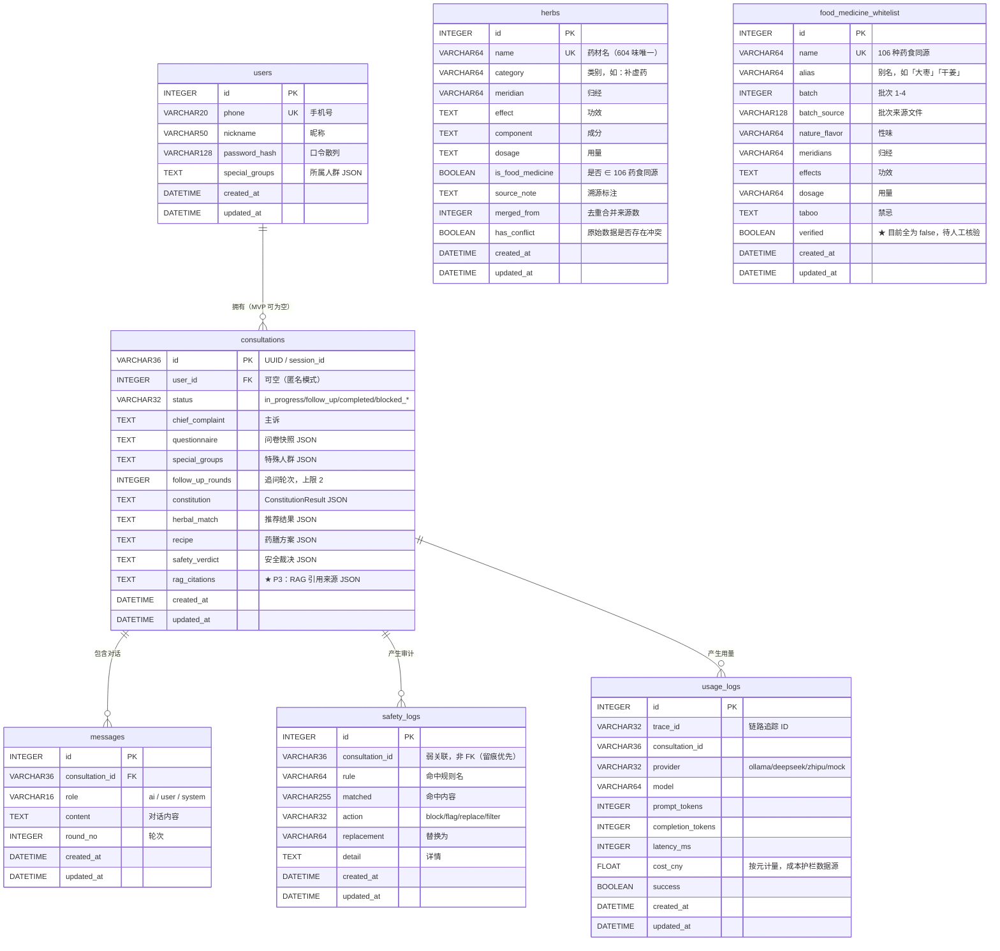

# 数据库设计说明（6.4.2）

> 字段定义以 `app/models/entities.py` 为准，本文为其可读版。
> 当前默认 **SQLite（WAL）**；生产可切 MySQL 8.0 —— 同为 SQLAlchemy URL，只换连接串，ORM 层零改动。

---

## 一、ER 图



---

## 二、分表职责与关键设计决策

### 2.1 `herbs` 与 `food_medicine_whitelist` 必须分开（ADR-004）

这两张表是**整个系统安全模型的基础**，绝不能合并。

| | `herbs` 查询层 | `food_medicine_whitelist` 推荐层 |
| --- | --- | --- |
| 数据量 | 604 味唯一药材（828 条原始记录去重后）+ 白名单补齐 22 味 | 106 种 |
| 用途 | 搜索、查看性味归经功效 | 体质匹配、药膳推荐 |
| 强制约束 | **只读，绝不进方案** | **硬白名单，非此即禁** |

同一味「附子」：在 `herbs` 里**查得到**（有 `is_blacklisted=true` 标记），
但永远不会出现在 `consultations.herbal_match` 里。这条不变量由
`tests/test_safety_guard.py::TestBlacklist::test_附子必须被推荐层拒绝` 锁死。

> ⚠️ 论文口径：不要把 828 当品种数。828 是原始**记录条数**，去重后唯一药材只有 604 味。

### 2.2 JSON 列存快照，而不是拆成子表

`constitution` / `herbal_match` / `recipe` / `safety_verdict` / `rag_citations` 都是 Text 列存 JSON。
理由是这些结构**随算法演进频繁变化**（比如 P3 新增 `rag_citations`），
拆成子表意味着每次改算法都要做一次迁移。存 JSON 的代价是无法用 SQL 查询内部字段——
但当前的查询形态都是「按 consultation_id 取整条」，不需要按内部字段筛选。

`created_at` 上的索引保证了「历史列表 / 趋势图」这类只取最近 N 条的场景不受影响。

### 2.3 `safety_logs` 用弱关联而非外键

`consultation_id` 没有 FK 约束。原因：**留痕优先**。
有些安全事件发生在问诊记录落库之前（比如输入侧急症拦截），
如果加外键，这些记录就写不进去了——而它们恰恰是最该审计的那些。

---

## 三、索引清单（6.2.2）

| 表 | 索引 | 服务场景 |
| --- | --- | --- |
| `herbs` | `ix_herbs_name`（唯一） | 按名精确查询 |
| `herbs` | `ix_herbs_category` / `ix_herbs_meridian` / `ix_herbs_is_food_medicine` | 筛选面板三档过滤 |
| `consultations` | `ix_consultations_created_at` | 历史列表、趋势图按时间倒序 |
| `consultations` | `ix_consultations_user_created`（复合） | 「某用户的历史」这一最常见形态 |
| `consultations` | `ix_consultations_status` / `ix_consultations_user_id` | 按状态/用户筛选 |
| `messages` | `ix_messages_cid_round`（复合） | 详情页取整段对话 |
| `safety_logs` | `ix_safety_logs_rule` / `ix_safety_logs_created_at` | 审计规则归类与时间排序 |
| `usage_logs` | `ix_usage_logs_trace_id` / `ix_usage_logs_consultation_id` | 链路追踪与成本归因 |

> 6.2.2 新增的索引写在 `_EXTRA_INDEXES`，由 `init_db()` 里的 `_migrate_add_indexes()`
> 以 `CREATE INDEX IF NOT EXISTS` 幂等补齐——因为 `create_all` 只建缺失的表，不会给已有表加索引。

---

## 四、SQLite 并发配置（6.2.2）

主库与 LangGraph Checkpointer 都开了：

```sql
PRAGMA journal_mode = WAL;   -- 读写不互斥；默认模式下一个写事务锁全库
PRAGMA busy_timeout  = 8000; -- 拿不到锁先等 8s，而不是立刻报 database is locked
```

实测（6.1.4）：并发 16 打 100 次问诊——

| | 修复前 | 修复后 |
| --- | --- | --- |
| 成功率 | 97/100（3 次 500） | **100/100** |
| p50 | 1129 ms | **395 ms** |
| 吞吐 | 8.5 req/s | **11.1 req/s** |

---

## 五、迁移策略

| 环境 | 方式 |
| --- | --- |
| 开发期 | `Base.metadata.create_all()` + `_migrate_add_columns()` + `_migrate_add_indexes()` 自动补 Structure |
| 生产 | 应走 Alembic；当前两个 `_migrate_*` 只是轻量兼容层，避免升级后老库直接崩 |

已知待补：**Alembic 迁移脚本尚未编写**（清单 1.3.3 / 1.3.4 未完成）。
毕业答辩前若要演示「平滑升级」，建议补一版初始 revision。
