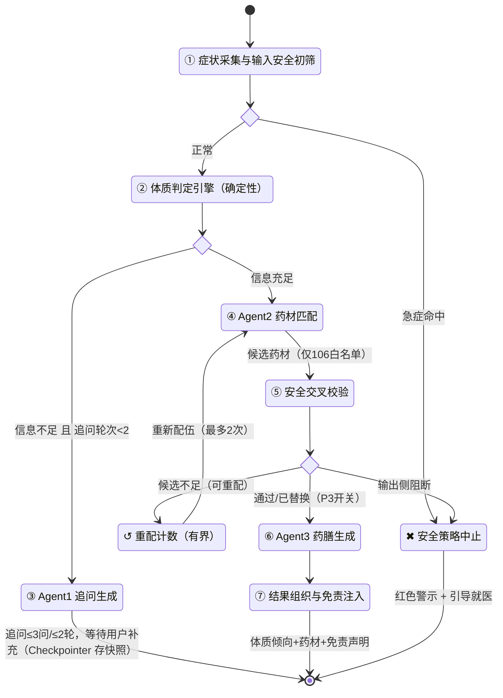
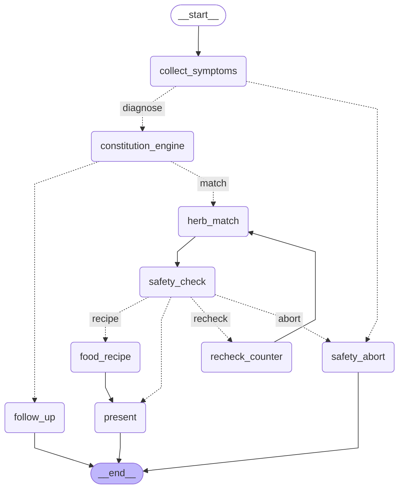

# 问诊状态图（LangGraph）—— 论文第四章配图源码

> 本文件由代码自动导出，**不要手改**。
> 导出来源：`backend/app/orchestration/graph.py::mermaid()`，节点标签查 `nodes.py::NODE_LABELS`。
> 重要性：论文里的流程图与线上跑的图是同一份定义，避免「图上画的和代码跑的不一致」。

## mermaid



## LangGraph 自导出（交叉验证用）



## 节点结构（JSON）

```json
{
  "engine": "langgraph",
  "nodes": [
    {
      "id": "collect_symptoms",
      "label": "① 症状采集与输入安全初筛"
    },
    {
      "id": "constitution_engine",
      "label": "② 体质判定引擎（确定性）"
    },
    {
      "id": "follow_up",
      "label": "③ Agent1 追问生成"
    },
    {
      "id": "herb_match",
      "label": "④ Agent2 药材匹配"
    },
    {
      "id": "safety_check",
      "label": "⑤ 安全交叉校验"
    },
    {
      "id": "food_recipe",
      "label": "⑥ Agent3 药膳生成"
    },
    {
      "id": "present",
      "label": "⑦ 结果组织与免责注入"
    },
    {
      "id": "safety_abort",
      "label": "✖ 安全策略中止"
    },
    {
      "id": "recheck_counter",
      "label": "↺ 重配计数（有界）"
    },
    {
      "id": "START",
      "label": "START"
    },
    {
      "id": "END",
      "label": "END"
    }
  ],
  "edges": [
    {
      "from": "START",
      "to": "collect_symptoms"
    },
    {
      "from": "herb_match",
      "to": "safety_check"
    },
    {
      "from": "food_recipe",
      "to": "present"
    },
    {
      "from": "present",
      "to": "END"
    },
    {
      "from": "safety_abort",
      "to": "END"
    },
    {
      "from": "follow_up",
      "to": "END"
    },
    {
      "from": "recheck_counter",
      "to": "herb_match"
    }
  ],
  "conditional_edges": [
    {
      "from": "collect_symptoms",
      "branches": [
        {
          "when": "safety_abort",
          "to": "safety_abort"
        },
        {
          "when": "diagnose",
          "to": "constitution_engine"
        }
      ]
    },
    {
      "from": "constitution_engine",
      "branches": [
        {
          "when": "follow_up",
          "to": "follow_up"
        },
        {
          "when": "match",
          "to": "herb_match"
        }
      ]
    },
    {
      "from": "safety_check",
      "branches": [
        {
          "when": "recheck",
          "to": "recheck_counter"
        },
        {
          "when": "abort",
          "to": "safety_abort"
        },
        {
          "when": "recipe",
          "to": "food_recipe"
        },
        {
          "when": "present",
          "to": "present"
        }
      ]
    }
  ]
}
```
