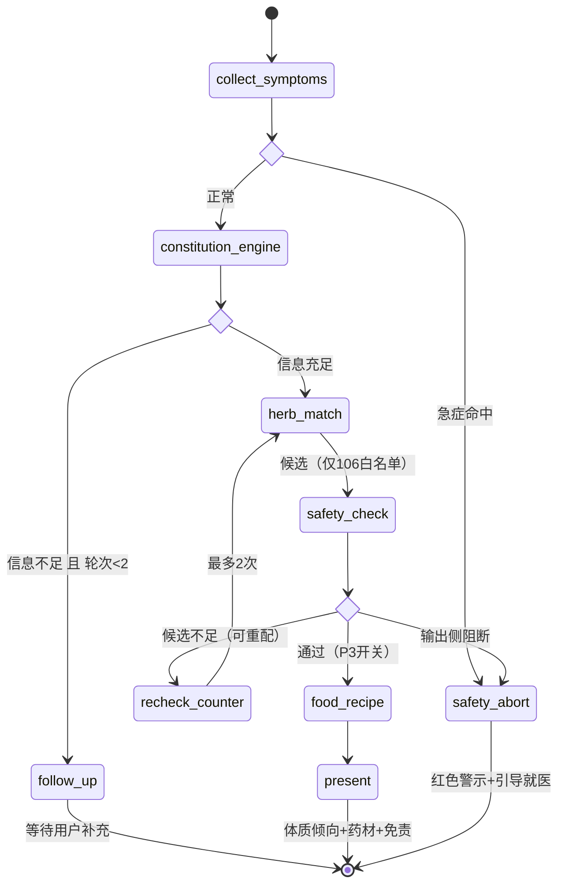

# 阶段性开发报告 · P2 多智能体编排（LangGraph）

> 上一阶段：`docs/阶段性开发报告_P0P1.md`
> 本阶段范围：开发步骤清单 **3.4**（LangGraph 状态机）+ **3.6**（会话持久化）
> 日期：2026-10-11

---

## 一、本轮交付

把 P1 里写在 `consultation_service._advance()` 中的**线性 if/else 流水线**，替换为**显式的 LangGraph 状态图**。测试数 **97 → 135**，全部通过。

| 项 | P1 | P2 |
|---|---|---|
| 编排方式 | service 手写 if/else | LangGraph StateGraph + 条件边 |
| 模块 | `services/consultation_service.py` 一肩挑 | 新增 `app/orchestration/`（state / nodes / edges / graph / runner） |
| 状态载体 | 函数局部变量 | `ConsultationState`（TypedDict + 显式归约器） |
| 会话恢复 | 靠 DB 问卷快照 | 同上（DB）**+ Checkpointer 快照**（双保险） |
| 图可视化 | 无（手画） | `GET /api/v1/consultation/graph` 导出 mermaid |
| SSE | 事后重放文本 | 边跑图边推**节点级事件** |
| 追问轮次 | ❌ 计数不递增，可无限追问 | ✅ 图上有界，测试用例锁死 |

---

## 二、状态图

完整源码见 `docs/状态图_LangGraph.md`（**由代码导出，非手写**）。



### 节点职责与「谁调 LLM」

| 节点 | 类型 | LLM | 说明 |
|---|---|---|---|
| ① collect_symptoms | 规则 | ✗ | 自由文本 → 结构化答案；特殊人群识别；输入侧急症闸 |
| ② constitution_engine | **规则** | ✗ | GB/T 46939—2025 等级计分，可复现 |
| ③ follow_up (Agent1) | LLM | ✓ | 追问生成，失败降级模板 |
| ④ herb_match (Agent2) | 规则+LLM | △ | 候选来自规则表（限 106 白名单）；仅「解读文案」用 LLM |
| ⑤ safety_check | 规则 | ✗ | **二次交叉复核** + 输出侧术语过滤 + 免责注入 |
| ⑥ food_recipe (Agent3) | LLM | ✓ | P3，默认关闭（`enable_recipe` 开关） |
| ⑦ present | 规则 | ✗ | 结果组织 |
| ↺ recheck_counter | 规则 | ✗ | 重配计数，**让「循环有界」在图上一眼可见** |

> 关键：⑤ 与 ④ 内部的安全过滤是**两个不同检查点**。④ 过滤的是「截断前的完整候选」，⑤ 复核的是「最终要呈现给用户的结果」——包括 LLM 生成的自由文本，以及匹配器可能引入的替换品种。

---

## 三、架构不变量（已进 CI 测试）

`tests/test_orchestration.py::TestArchitectureFitness` 用 **AST 级**检查（只看真实 import，注释里提到不算）：

| 约束 | 内容 |
|---|---|
| 领域层零框架 | `app/domain` 禁止 import langgraph / sqlalchemy / fastapi / openai / langchain |
| 编排层不碰 DB | `app/orchestration` 禁止 import sqlalchemy / fastapi |
| 单向依赖 | 编排层禁止 import `consultation_service`（否则成环） |
| service 不手写流水线 | `consultation_service.py` 里不得出现 `hm.match_herbs(` / `ce.score(` |

> 循环导入事故：编排层需要 `services.data_loader`，而 service 又需要编排层的节点标签。修法是**让 `app/services/__init__.py` 不做 eager import**，保持单向依赖。

---

## 四、修掉的一个真实缺陷

P1 的 `_advance()` 里：

```
consultation.follow_up_rounds = round_no        # 每次都被写成同一个值
```

而 `answer_consultation` 又从 `consultation.follow_up_rounds` 读回同一个值 —— 于是**轮次永远停留在 0，用户在信息不足时会陷入无限追问**，永远走不到出结论的分支。

P2 由 `follow_up_node` 在状态里自增 `follow_up_rounds`，条件边 `rounds < 2` 天然有界。回归测试：

```python
def test_追问最多两轮后必出结论(self):
    ...
    assert d3["phase"] == "completed", "第 3 次交互必须出结果，不得再追问"
```

这类 bug 正是「把隐式流程画成显式图」的价值 —— 画出来之后，边界一眼可见。

---

## 五、会话持久化（3.6）

按 `起步路线.md` 六，**Redis 降级为可选**，三项需求改由两步覆盖：

1. **LangGraph Checkpointer（SQLite）**——`var/langgraph_ckpt.sqlite`，按 `session_id`(=consultation_id) 存快照，同 thread_id 二次 invoke 自动恢复。
2. **DB 问卷快照**——每轮 `answer` 都把 `questionnaire` 同步写回 `consultations` 表。**即使 Checkpointer 文件丢失也能重建**（满足 `项目分析文档.md` 5.3「已采集信息不丢失」）。

> 实现细节：`SqliteSaver.from_conn_string()` 返回 context manager，退出 `with` 会关连接，而图是长生命周期单例 —— 改为自建 `sqlite3.connect(check_same_thread=False)` 后手动 `setup()`。

---

## 六、新增接口

| 方法 | 路径 | 用途 |
|---|---|---|
| POST | `/api/v1/consultation/stream` | SSE 边跑图边推：`node` / `meta` / `delta` / `question` / `done` / `error` |
| GET | `/api/v1/consultation/graph` | 状态图结构与 mermaid（`?format=mermaid`） |
| GET | `/api/v1/consultation/{id}/stream` | 事后重放（P1 保留） |

SSE 事件序列实测：

```
node collect_symptoms → node constitution_engine → node herb_match
→ node safety_check → meta(provider=ollama,model=qwen3:8b) → node present
→ delta ×N → done
```

---

## 七、验证结果

```
135 passed in 1.3s
```

- `scripts/demo_consultation.py` 新增 **E. P2 多智能体编排** 章节：拓扑打印、真实执行轨迹、六条条件分支覆盖、SSE 事件流。
- 本机 `ollama + qwen3:8b` 真实链路已跑通；`--provider mock` 全离线可用。

**两条红线仍然自动成立**：

| 用例 | 断言 |
|---|---|
| `test_交叉复核剔除黑名单` | 「附子」被 safety_check 节点拦下 ✓ |
| `test_推荐药材全部在白名单` | 输出候选恒 `in_whitelist=True` ✓ |
| `test_急症拦截并落阻断状态` | 40301 + `blocked_emergency` ✓ |

---

## 八、遗留风险

1. **106 白名单仍是初稿**（`verified=false`）——与 P1 相同，未变化，仍是最高优先级人工核验项。
2. **GB/T 46939—2025 原文未获取**——替换 `questionnaire.py` 题面即可，计分与图结构无需改动。
3. **Checkpointer 文件会随时间增长**——每次问诊一个 thread，长期需清理策略（`saver.prune()`）；毕设演示规模无影响。
4. **Agent3 药膳节点尚未在真实场景验证**——P3 开关默认关闭，开启后需补一组人工评审用例。

---

## 九、下一步

- **P3**：开启 `enable_recipe` → Agent3 药膳生成 + `RecipePlan` 结构化输出 + 禁忌表联动。
- **前端**：`/consultation/graph` 已有结构 JSON，可直接画进度条；SSE 的 `node` 事件即节点高亮数据源。
- **论文第四章**：状态图直接用 `docs/状态图_LangGraph.md`，不需要再手画。
