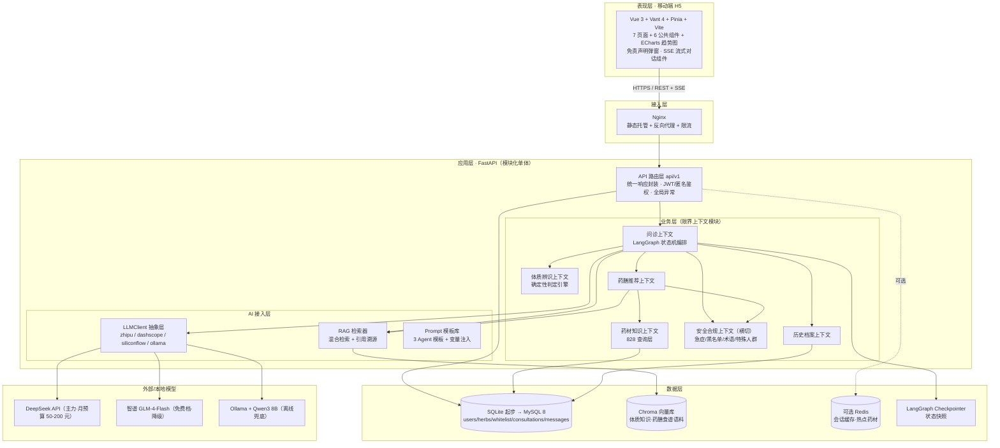
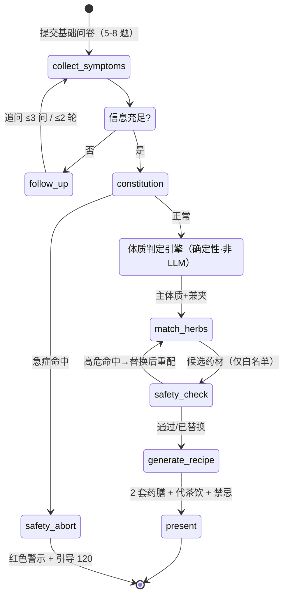
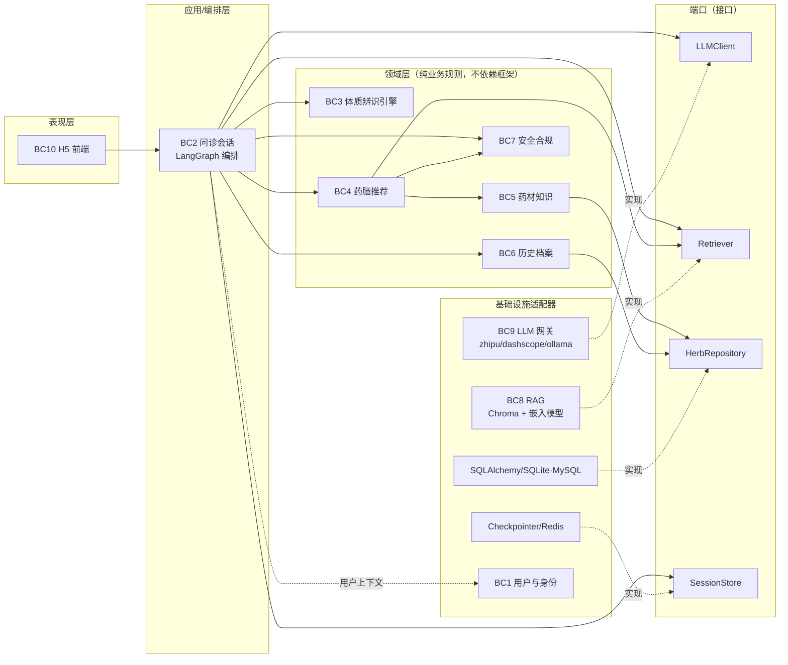
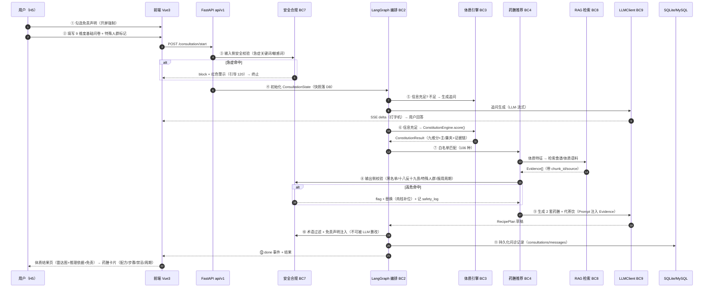
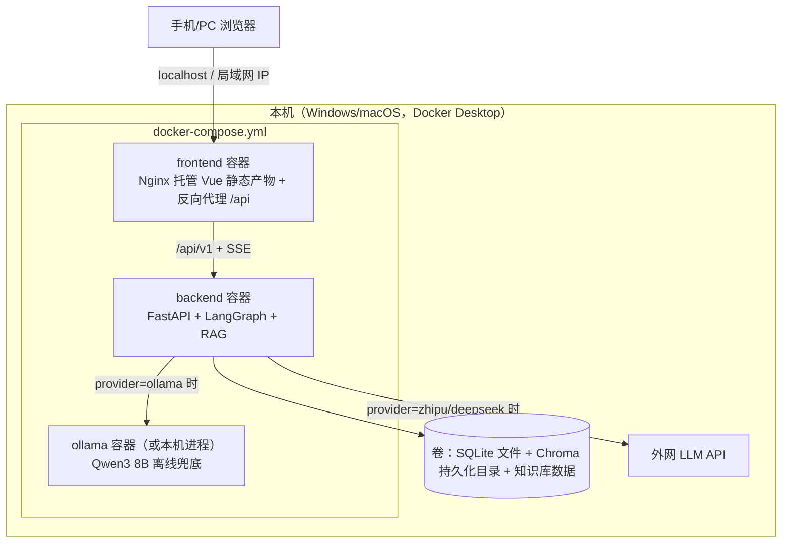

# 中医药智慧康养系统 · 系统整体架构设计

> 题目：**基于多智能体协同与检索增强生成的中医药智慧康养系统的设计与实现**
> 文档性质：系统整体架构设计（模块划分 / 技术选型 / 数据流 / 部署形态），面向毕业设计学术研究与演示场景
> 编写日期：2026-10-08
> 依据文档：`项目分析文档.md`、`开发步骤清单.md`、`最终效果与使用步骤.md`、`项目全景梳理.md`、`起步路线.md`、`第一章_绪论.md`、`参考文献/参考文献清单.md`
> 阅读状态：上述 7 份文档均已完整读取；`参考文献/中文期刊论文清单.md` 未逐行阅读（其内容为中文文献获取途径，不影响架构决策，仅知其中 C1《中医体质分类与判定》为核心必引，见 `项目全景梳理.md` C6）。

**置信度标注约定**：本文每个重要决策标注 `【置信度：高/中/低｜依据：文档名·章节】`。
- **高** = 有明确文档陈述或标准/法规支撑；
- **中** = 文档有相关陈述但存在冲突，或属合理推断；
- **低** = 文档未覆盖，本文提出并列入待确认项。

---

## 目录

1. [需求提取摘要（含未知项）](#一需求提取摘要含未知项)
2. [架构总览](#二架构总览)
3. [模块划分（限界上下文）](#三模块划分限界上下文)
4. [关键接口与契约](#四关键接口与契约)
5. [技术选型](#五技术选型)
6. [数据流](#六数据流)
7. [部署形态](#七部署形态)
8. [非功能考量](#八非功能考量)
9. [与《开发步骤清单》的对齐](#九与开发步骤清单的对齐)
10. [待决事项清单](#十待决事项清单)
11. [附录：架构决策记录（ADR）](#十一附录架构决策记录adr)

---

## 一、需求提取摘要（含未知项）

### 1.1 系统目标

一句话定位（`项目分析文档.md` 1.4 / `项目全景梳理.md` 二）：**把"需要专业中医师才能做的事"变成"手机上 5 分钟就能做的事"**——面向普通用户的移动端 H5 中医药药膳养生辅助系统，以"多智能体协同 + RAG 检索 + 多层安全校验"保证输出可信、安全、个性化。

**定位红线**（`项目分析文档.md` 2.2.2 / `项目全景梳理.md` 二）：只做养生调理方向参考，**不做疾病诊断**；每次输出强制附免责声明。在医疗 LLM 自主性分级（文献 [23]）中定位于 **L0–L1 信息工具**，本架构一切设计均服务于守住这条线。

**学术目标**（`第一章_绪论.md` 1.4.1）：
1. 实现体质智能辨识、个性化药膳推荐、药膳知识查询等核心功能；
2. 基于 LangGraph 的多智能体协同架构（体质辨证 / 药材匹配 / 药膳生成 3 个 Agent + 状态机编排）；
3. 中医药知识向量库 + RAG，降低幻觉（文献 [29] 证明"医学专精模型反而更易幻觉"，故不能指望微调，须检索有据 + 交叉校验）；
4. 多层安全机制（急症拦截、高危药材过滤、特殊人群保护）；
5. 移动端 H5，"表单结构化 + AI 追问"混合交互。

### 1.2 核心功能需求（6 大业务场景 × 6 大任务）

来源：`项目分析文档.md` 第三、四章；`最终效果与使用步骤.md` 第一、二章。

| # | 业务 | 一句话 | 关键处理 | 输出 |
|---|------|--------|----------|------|
| 业务一 | 体质智能辨识 | 帮用户回答"我是什么体质" | 结构化问卷（9 维度）+ AI 追问 1-2 轮（每次 ≤3 问） | 主体质 + 1~2 兼夹体质 + 推理依据 + 9 维雷达图 |
| 业务二 | 个性化药膳推荐 | 帮用户回答"我该吃什么" | 体质匹配药材 → 2 套药膳方案（汤/粥/茶）+ 代茶饮 + 禁忌标注 | 食疗方案卡片（含配方、火候时间用量、食用指导、禁忌、服用周期） |
| 业务三 | 药膳食疗知识查询 | 帮用户回答"这个药材有什么用" | 本地知识库检索（名称/类别/归经筛选）+ AI 拓展分析 | 结构化药材详情 |
| 业务四 | 特殊人群安全保护 | 帮用户避免"吃了不该吃的" | 主动采集孕妇/哺乳/儿童/慢病信息 → 过滤禁用药材 → 安全品种补位 → 风险标注 | 人群定制的安全方案 |
| 业务五 | 问诊历史与体质追踪 | 帮用户记录"我调理得怎么样" | 保存问诊全记录 → 体质变化趋势对比 | 历史列表 + 趋势图（ECharts） |
| 业务六 | 安全兜底与合规 | 帮系统守住"不越界"底线 | 急症拦截→红色警示→引导 120；输出术语过滤；免责声明强制；健康数据加密 | 拦截警示 / 安全标记 / 替换后方案 |

**用户旅程**（`最终效果与使用步骤.md` 10 步）：打开 → 免责声明勾选 → 注册登录 → 体质测试（表单 5-8 题 → AI 追问 → 结果）→ 药膳推荐 → 保存/分享 → 药材查询 → 历史 → 复测追踪。

### 1.3 约束条件

**法律合规约束**（`项目分析文档.md` 6.1）：严禁输出疾病诊断结论；健康数据属敏感个人信息（PIPL，AES-256 加密存储）；算法备案、ICP/公安备案（若上线）；免责声明开屏 + 每次输出强制展示。

**技术约束**（`项目分析文档.md` 6.2、`最终效果与使用步骤.md` 四）：
- LLM 单请求 Token 上限 → Prompt 长度控制 + 历史压缩；
- 响应延迟：AI 追问首字 <3s、药膳生成 <10s、SSE <500ms/字、药材搜索 <500ms、DB 查询 <100ms、首页 <2s；
- 并发 >100 用户（**注：与学术演示定位存在张力，见未知项 U12**）；
- 问诊记录不能丢失（持久化 + 缓存双写）。

**业务约束**（`项目分析文档.md` 6.3）：推荐药材必须真实存在（禁止虚构）；体质分类必须符合国家标准（仅九种）；方案可操作（具体到火候、时间、用量）；安全兜底"宁可错杀不可放过"。

**资源约束**（`起步路线.md` 文首，**最新，2026-10-08**）：
- 交付周期 **3–6 个月**；
- **828 味药材数据可以拿到**，但须与推荐层隔离（828 做查询、106 做推荐）；
- **预算约束（2026-10-08 用户拍板更新，取代 `起步路线.md` 的"零预算"口径）**：仅 **LLM API 调用费**可支出，月预算 **50–200 元**；嵌入、部署、数据库等其余环节维持零成本 → LLM 主力走 DeepSeek 付费 API（deepseek-chat 全程 + reasoner 仅关键环节），保留免费档/本地模型降级，必须做 LLM 供应商抽象层 + 成本护栏（token 计量、预算告警、超限自动降级）。

**领域规则约束**（`项目分析文档.md` 5.1/5.2/5.3，可直接转为代码常量表）：九种体质（平和/气虚/阳虚/阴虚/痰湿/湿热/血瘀/气郁/特禀）；药材选取优先药食同源、规避十八反十九畏；追问 ≤3 问、不强行辨证；输出用倾向性表述（禁"你是XX体质"）、禁"治疗/治愈/祛病"；每次 2 套药膳；服用不超 2-4 周；急症关键词立即终止问诊；高危药材黑名单（附子、川乌等 30+ 种）硬拦截 + 自动替换 + 记日志。

### 1.4 文档间矛盾与未知项 / 待确认

> 以下均按"不臆造"原则列出。文档间冲突的，本文给出建议方案但**不代替用户拍板**。

#### A. 文档间矛盾（已有明确证据）

| # | 矛盾 | 冲突双方 | 本文建议 | 置信度 |
|---|------|----------|----------|--------|
| C1 | **LLM 选型** | `项目分析文档.md` 9.2 / `开发步骤清单.md` 附录 = DeepSeek API（deepseek-chat，付费）；`起步路线.md` 二 = 零预算 → 智谱 GLM-4-Flash 免费档 + Ollama/Qwen3 兜底 | **已拍板（D1，2026-10-08）**：DeepSeek 为主力（deepseek-chat 全程，deepseek-reasoner 仅关键环节），GLM-4-Flash 免费档 + Ollama/Qwen3 作降级兜底；LLM 抽象层兼容全部 provider 并内置成本护栏（月预算 50–200 元） | 高（已拍板） |
| C2 | **推荐药材的合法性边界** | `项目分析文档.md` 6.3"仅从 828 味本地知识库选取"；`起步路线.md` 1.1 明确指出**该规则本身是错的**，应为"推荐必须来自 106 种药食同源白名单；828 味仅用于查询展示" | 采用 `起步路线.md` 的双层数据架构（法规依据：药膳属普通食品，严禁添加非药食同源物质） | 高（`起步路线.md` 1.1 有法规论证） |
| C3 | **药食同源口径** | `项目分析文档.md` 8.2 称原项目"20 味药食同源"；`开发步骤清单.md` 4.1.2 称国家目录"约 110 种"；`起步路线.md` 1.3 已逐条点数核实为 **106 种**（4 批次，截至 2026-05），并警告按顿号硬切会数出 110 条脏数据 | 以 **106 种** 为准，解析时做括号感知切分；"20 味"疑为原项目子集。**待用户确认（D6）** | 中高 |
| C4 | **体质判定标准版本** | `项目分析文档.md` 5.1 / `第一章_绪论.md` 引 2009 年行业标准 ZYYXH/T157-2009；`参考文献清单.md` [S1] 证实 **GB/T 46939—2025** 已于 2026-04-01 实施并取代前者 | 全部改引 GB/T 46939—2025，判定算法对齐其"典型体感问题 + 等级计分算法" | 高 |
| C5 | **体质判定由谁做** | `项目分析文档.md` 10.1 让 Agent1（LLM）做 diagnose；`起步路线.md` 四要求**体质判定用确定性算法（不用 LLM）**，LLM 只做追问生成与通俗化 | 采纳 `起步路线.md`：判定 = 规则引擎（可复现、可单测，论文设计亮点）；Agent1 重定义为"问诊对话 Agent（追问 + 通俗化）" | 高（国家标准即给计分算法；文献 [29] 支持少依赖 LLM 做确定性判断） |
| C6 | **API 路径前缀** | `项目分析文档.md` 十三用 `/api/herbs`；`开发步骤清单.md` 用 `/api/v1/herbs` | 统一 `/api/v1`（`起步路线.md` 附亦如此要求） | 高 |
| C7 | **开发步骤清单文首统计错误** | 文首"14 周 / 5 阶段 / 68 任务"；实为 **6 阶段 / 157 任务**（`项目全景梳理.md` B2 逐阶段核对） | 按 6 阶段 / 157 任务执行 | 高 |
| C8 | **部署目标** | `开发步骤清单.md` 6.3 = 云服务器上线（Nginx/HTTPS/ICP 备案）；`起步路线.md` 六 = 砍成本机 docker-compose 演示 | 分两档：MVP 本机演示必做；上线作为扩展路径（视论文要求，**D4**） | 中 |
| C9 | **用户系统范围** | `项目分析文档.md` 4.2 任务6 = 完整注册登录 + JWT + 权限；`起步路线.md` 六 = 降级为单用户，最后有空再加 | MVP 先单用户（可匿名+本地存储），JWT 预留接口设计，作为最后冲刺项（**D2**） | 中 |
| C10 | **项目命名三套并存** | "中医药智慧康养系统"（论文题）/ "药膳养生AI系统"（开发步骤标题）/ `herb-health-ai`（目录）/ herbal-health.com（域名） | 对外统一用论文题目；代码目录 `herb-health-ai` 保留 | 中 |

#### B. 未知项 / 待确认（文档未覆盖，不臆造）

| # | 未知项 | 影响 | 建议获取途径 |
|---|--------|------|--------------|
| U1 | **828 味数据的真实字段结构**（JSON 是 list 还是 dict、字段名、编码） | 决定导入脚本、ORM 模型、切片策略；`起步路线.md` 明确"不要按'应该是这样'猜字段名" | 克隆 `zisu7/herb-llm-agent` 后体检并贴出首条记录结构（`起步路线.md` 第 0 周 D2） |
| U2 | **GB/T 46939—2025 的完整计分算法与典型体感问题条目** | 体质判定引擎的核心输入；工作区内无标准全文（仅清单转述） | 购买/获取标准原文（openstd.samr.gov.cn，`参考文献清单.md` [S1] 给出查询地址） |
| U3 | **体质→药材匹配规则表的内容与依据** | `起步路线.md` 四-3 要求"先写死规则表"，但规则表由谁编写、依据教材哪一章、覆盖多少组合未定义 | 需中医专业依据（教材/药典条目页码），或由导师确认规则表口径 |
| U4 | **药膳食谱/配方库的来源与规模** | `起步路线.md` P3 提到"药膳食谱库"，但来源、条数、版权未定义；影响 RAG 语料与"2 套方案"的多样性 | 明确来源（教材/公开食谱/自编），并做溯源标注 |
| U5 | **106 味白名单 9 字段的填充质量**（106×9=954 格，`起步路线.md` 1.4） | 安全关键数据；禁忌、特殊人群标记错误直接导致安全风险 | LLM 批量生成初稿 + 人工逐条核对药典（起步路线 D4 已排入计划） |
| U6 | **嵌入（Embedding）模型选型** | 所有文档均未指定向量化模型；付费 embedding API 已被排除（2026-10-08 用户拍板：预算仅覆盖 LLM API） | 本地开源中文嵌入模型（见 5.2.4）；**D10 已拍板选 B/C**，bge-small-zh-v1.5 与 Ollama 嵌入二选一后写入 `.env.example` |
| U7 | **"AI 拓展分析（非本地知识库内容）"的边界与标注方式** | `项目分析文档.md` 业务三允许 AI 补充非知识库内容，但 6.3 又要求"禁止虚构"——两者的区分/标注机制未定义 | 建议契约中强制 `knowledge_grounded: bool` + 引用来源标注（见 4.1） |
| U8 | **体质雷达图"9 维度得分"的定义** | 国标是"等级计分"（转化分），文档展示的是 0-100% 条形图；映射关系未定义 | 对齐国标转化分公式（0-100 分），前端展示即用转化分 |
| U9 | **评估方案细节**（有/无 RAG 对比实验的评测集、指标、人工评分人数） | `开发步骤清单.md` 4.5.3 与 `起步路线.md` P5 要求对比实验，但评测集规模/指标/评分人未定义 | 建议自建 30-50 题评测集 + 安全用例集（见 8.5），**D11** |
| U10 | **特殊人群规则库的完整条目**（孕妇/哺乳/儿童/慢病各自禁用清单） | `项目分析文档.md` 5.2 只给了原则，未给逐味药材标记 | 与 U5 合并处理（`special_groups` 字段） |
| U11 | **会话中断恢复的持久化语义**（30 分钟过期后"已采集信息不丢失"落在哪） | 影响 checkpointer/存储设计 | 建议：Redis/内存缓存可丢，但问卷快照落库（见 4.6） |
| U12 | **"并发 >100 人"指标与演示定位的匹配度** | 若要求真实 100 并发，需压测与容量设计；纯演示可降级 | **D12**：确认是论文指标声明还是实测要求 |
| U13 | **828 味数据的授权/引用口径** | `起步路线.md` 七：答辩必被问"数据哪来的" | 溯源表：828 标原仓库 + "仅供参考"；106 标卫健委公告批次 |

---

## 二、架构总览

### 2.1 架构风格决策

**ADR-001：模块化单体（Modular Monolith），而非微服务。**
【置信度：高｜依据：`项目全景梳理.md`（文档齐备、代码为零、单人毕设）；`起步路线.md`（3-6 个月；原"零预算"约束经 2026-10-08 拍板更新为"仅 LLM API 月预算 50–200 元"）】

- 理由：单人开发、学术演示、零运维预算。微服务把复杂度从代码搬进基础设施（服务发现、分布式追踪、网络失败模式），对本项目只有成本没有收益；但模块边界按限界上下文严格切分（见第三章），保证**未来可拆分**——"部署形态是单体，设计形态是分布式的"。
- 被否方案：微服务（团队规模与运维成本不匹配）；无边界单体（即原项目 `main.py` 420 行大泥球，`项目分析文档.md` 8.3 已诊断为反模式）。
- 演进路径：模块化单体 → 按需把"RAG 知识服务"或"安全服务"拆出（仅当出现独立扩展/独立团队需求）。

**ADR-002：确定性规则做判定，LLM 只做语言层。** 见 5.2.1 详述。【置信度：高｜依据：`起步路线.md` 四；GB/T 46939—2025 [S1]；文献 [29]】

### 2.2 架构分层总览



### 2.3 多智能体编排拓扑

**ADR-006：集中式编排（1 个编排器 + 3 个专职 Agent + 1 个规则引擎）。**
【置信度：高｜依据：`项目分析文档.md` 10.1 状态机；文献 [7]（centralized 结构分类）；文献 [12]（LangGraph typed state + 条件路由）】



> 与 `项目分析文档.md` 10.1 的差异：原设计 `diagnose (Agent1)` 由 LLM 做体质辨证；按 `起步路线.md` 四-1（GB/T 46939—2025 给的就是确定性计分算法，用 LLM 反而不可复现），**diagnose 节点改为确定性规则引擎**，LLM 只承担追问生成与结果通俗化。此调整见第九章步骤清单修订。

---

## 三、模块划分（限界上下文）

### 3.1 上下文映射总表

| 限界上下文 | 核心职责 | 上游依赖 | 下游消费者 | 关键不变量 |
|-----------|----------|----------|------------|-----------|
| **BC1 用户与身份**（可降级） | 注册/登录、JWT 签发校验、用户档案 | — | BC6 | 密码不落明文；Token 过期可续 |
| **BC2 问诊会话**（核心） | 问卷流转、LangGraph 编排、多轮追问、会话状态 | BC3/BC4/BC5/BC7/BC8 | API 层 | 信息不足不强行辨证；追问 ≤3 问 |
| **BC3 体质辨识** | 确定性判定引擎（GB/T 46939—2025 计分）、9 维得分 | — | BC2/BC4 | 仅输出九种标准体质；主体质+1~2 兼夹；可复现 |
| **BC4 药膳推荐** | 白名单匹配、2 套方案 + 代茶饮、禁忌/周期标注 | BC3/BC5/BC7 | BC2 | **推荐药材必须 ∈ 106 白名单**；每次恰好 2 套 |
| **BC5 药材知识（查询层）** | 828 味百科检索、类别/归经筛选、白名单标记 | — | BC4/API | 828 只读展示、永不进方案 |
| **BC6 历史档案** | 问诊记录持久化、体质趋势 | BC1 | API | 问诊记录不丢失 |
| **BC7 安全合规（横切）** | 急症拦截、黑名单、医疗术语过滤、特殊人群规则、免责声明注入 | — | BC2/BC4/API 前后置 | 高危宁可错杀；免责声明不可被 LLM 改写 |
| **BC8 知识检索（RAG）** | 文档切片、嵌入、向量索引、混合检索、证据溯源 | — | BC2/BC4 | 检索证据必须可溯源到源文档 |
| **BC9 LLM 接入网关** | 多 provider 抽象、重试/限流/超时、Token 统计 | 外部模型 | BC2/BC4 | 业务代码零 provider 依赖 |
| **BC10 表现层 H5** | 7 页面、SSE 流式、免责声明、雷达图 | API | 用户 | 免责声明开屏强制；表单数据断网不丢 |

### 3.2 模块依赖方向图



**依赖方向铁律**（`项目分析文档.md` 9.1 分层 + DDD 依赖倒置）：
1. 领域层（BC3/BC4/BC5/BC7/BC6）**禁止** import LangGraph、LLM SDK、SQLAlchemy、FastAPI；
2. BC7 安全合规是横切关注点，被 BC2/BC4 调用，**不反向依赖**任何业务上下文；
3. 外部资源（LLM/向量库/DB）只通过端口接口注入，业务代码零 SDK 依赖——这条同时是"LLM 供应商解耦"（`起步路线.md` 二）与"可测试性"的保证；
4. 架构适应度函数（进 CI，见 8.2）：`grep -r "from langgraph" app/domain/` 必须为空。

---

## 四、关键接口与契约

> 契约级描述（字段 + 语义 + 约束），不写完整实现代码。

### 4.1 核心领域数据结构

**① ConstitutionResult（体质判定结果，BC3 → BC2/BC4）**
```json
{
  "primary": "阳虚质",                  // 必须 ∈ 九种标准体质
  "secondary": ["气虚质"],               // 0~2 个兼夹
  "scores": {"平和质": 30, "气虚质": 80, "阳虚质": 85, "...": 0},  // 九维转化分 0-100
  "evidence": ["怕冷、手脚冰凉 → 阳虚质条目 3.2", "..."],          // 逐条对应问卷答案
  "standard": "GB/T 46939—2025",
  "confidence_flag": "倾向性判定",        // 固定措辞，禁止"你就是XX体质"
  "deterministic": true                  // 恒为 true；供审计区分规则结论与 LLM 话术
}
```
不变量：`primary` 必属九种；`scores` 九键齐全；同一问卷输入必得同一输出（可单测）。
【置信度：高（结构）｜`项目分析文档.md` 任务1；[S1] ｜`scores` 为 0-100 转化分是本文建议，见 U8，置信度中】

**② HerbMatchResult（药材匹配结果，BC4 内部契约）**
```json
{
  "candidates": [
    {"herb_id": 1024, "name": "黄芪", "in_whitelist": true,
     "reason": "阳虚质适配·补气升阳", "dosage": "9-30g",
     "contraindications": ["阴虚火旺慎用"], "special_groups": ["孕妇慎用"]}
  ],
  "rejected": [
    {"name": "附子", "reason": "黑名单命中", "replacement": "肉桂"}
  ],
  "rule_table_version": "v1.0"
}
```
不变量：`candidates[].in_whitelist` 恒为 true；任何 `in_whitelist=false` 或黑名单项必须进 `rejected` 并给出替换。
【置信度：高（白名单不变量）｜`起步路线.md` 1.1/1.5；规则表内容待定见 U3】

**③ RecipePlan（药膳方案，BC4 → BC2/前端）**
```json
{
  "recipes": [   // 恰好 2 套，类型轮换 汤/粥/茶
    {"name": "当归生姜羊肉汤", "type": "汤", "fit_constitution": "阳虚质",
     "ingredients": [{"name": "当归", "amount": "15g"}, {"name": "羊肉", "amount": "500g"}],
     "steps": ["羊肉切块冷水下锅焯水", "…"],          // 具体到火候/时间/用量
     "guidance": {"frequency": "每周 2-3 次", "duration": "2-4 周后暂停"}
    }
  ],
  "tea": {"name": "黄芪红枣茶", "formula": ["黄芪 5g","红枣 3 颗","枸杞 5g"], "steps": ["…"]},
  "warnings": {"taboo_foods": ["生冷寒凉"], "forbidden_groups": ["孕妇慎用当归"], "cycle_notice": "连续服用不超过 2-4 周"},
  "citations": [{"chunk_id": "herb:1024", "source": "《中国药典》黄芪条", "used_for": "用量"}],
  "knowledge_grounded": true
}
```
`citations` + `knowledge_grounded` 是对 U7 的回答：凡来自知识库的结论必须带溯源；LLM 补充的通俗话术标记为非知识库内容，前端区分展示。
【置信度：中（citations 机制为本文提出，`项目分析文档.md` 2.3.1"用事实约束生成"与文献 [16][17] 自反思检索支持该设计）】

**④ SafetyVerdict（安全裁决，BC7 → 调用方）**
```json
{
  "verdict": "pass | flag | block",     // block=终止问诊; flag=警示+替换后放行
  "triggers": [{"rule": "急症关键词", "matched": "胸痛", "action": "block"},
               {"rule": "高危黑名单", "matched": "附子", "action": "replace", "replacement": "肉桂"}],
  "disclaimer_required": true,           // 恒 true；前端强制渲染
  "log_ref": "safety_log:2026-10-08-0042" // 替换必须记日志（5.2 药材安全规则）
}
```
不变量：LLM 输出**不得**删除/改写免责声明（`项目分析文档.md` 5.3）；`block` 发生时问诊立即终止。
【置信度：高｜`项目分析文档.md` 5.2/5.3、十一安全机制清单】

**⑤ Evidence（RAG 证据，BC8 → BC2/BC4）**
```json
{
  "chunk_id": "recipe:037", "text": "…", "score": 0.83,
  "source": "药膳食谱库/《中药学》教材", "metadata": {"herb": "黄芪", "section": "用量"}
}
```

### 4.2 LLMClient 端口（BC9）

```
LLMClient:
  chat(messages: list[Message], *, temperature: float, max_tokens: int) -> str
  chat_stream(messages: list[Message], ...) -> Iterator[str]      # 逐 token，供 SSE
  count_tokens(text) -> int                                        # Prompt 长度控制（6.2 Token 约束）

配置切换：provider ∈ {zhipu, dashscope, siliconflow, ollama, deepseek}
横切能力：超时重试（429/5xx 指数退避）、Token 用量统计、调用日志（trace_id）
```
- 约束：**任何 Agent/服务代码不得直接 import 任一 provider SDK**（`起步路线.md` 二）。
- 流式语义：`chat_stream` 抛出的每段文本由 BC2 包装为 SSE `delta` 事件（见 4.5）。
【置信度：高｜`起步路线.md` 二（接口即其伪代码）；`开发步骤清单.md` 3.1.1-3.1.5】

### 4.3 Retriever 端口（BC8）

```
Retriever:
  retrieve(query: str, *, top_k: int = 5, filters: dict = None) -> list[Evidence]
  # filters 支持 {"herb": "黄芪", "type": "recipe|constitution|pharmacopoeia"}
```
- 混合检索：向量相似度 + 关键词（`开发步骤清单.md` 4.3.3），结果去重、排序、截断（4.3.4）；
- 分阶段能力：MVP 为扁平向量检索；进阶为层级摘要树（RAPTOR 式，文献 [18]）或图检索（GraphRAG，文献 [19][20][21]），**属论文扩展对比，不进 MVP**（见 5.2.3）。
【置信度：高（接口）｜`开发步骤清单.md` 4.3；中（进阶路线）】

### 4.4 确定性引擎接口（BC3）

```
ConstitutionEngine:
  score(questionnaire: dict[str, Answer]) -> ConstitutionResult
  # 纯函数、无 I/O、无 LLM；输入问卷答案，输出九维转化分 + 主/兼夹体质 + 证据链
  # 计分算法实现 GB/T 46939—2025「典型体感问题 + 等级计分」（细节待标准原文，U2）
```

### 4.5 REST API + SSE 事件契约

统一前缀 `/api/v1`（解决 C6）；统一响应封装 `{code, message, data}`；错误码表含 `401 未认证 / 429 限流 / 40301 急症拦截 / 40302 安全拦截` 等业务码。

```
# 药材知识（BC5，只读）
GET  /api/v1/herbs?page=&size=&category=&meridian=     # 列表+筛选；含 is_food_medicine 标记
GET  /api/v1/herbs/{id}                                 # 详情
GET  /api/v1/herbs/search?q=                            # 搜索
GET  /api/v1/herbs/categories | /api/v1/herbs/meridians

# 问诊（BC2）
POST /api/v1/consultation/start                         # body: 问卷答案 + 特殊人群标记 → consultation_id
POST /api/v1/consultation/{id}/answer                   # body: 追问回答 → {next: "follow_up|result", ...}
GET  /api/v1/consultation/{id}/stream                   # SSE 流式（见下）
GET  /api/v1/consultation/{id}                          # 记录详情（含 ConstitutionResult/RecipePlan/SafetyVerdict）

# 历史（BC6）
GET  /api/v1/user/history                               # 问诊历史列表
GET  /api/v1/user/trend                                 # 体质趋势（多期转化分）

# 用户（BC1，MVP 可降级为无鉴权/本地模式）
POST /api/v1/user/register | /api/v1/user/login | GET /api/v1/user/profile
```

**SSE 事件契约**（修复 `项目全景梳理.md` C4 指出的接口不完整）：
- 鉴权：`Authorization: Bearer <JWT>` 请求头（SSE 为 GET、由 EventSource/polyfill 带 fetch 置头；不把 Token 放 Query，避免日志泄漏）；
- 参数：`GET /api/v1/consultation/{id}/stream?phase=follow_up|constitution|recipe`；
- 事件类型：
  - `event: delta` ｜ `data: {"text": "…"}` —— 逐段文本（打字机效果）；
  - `event: meta` ｜ `data: {"node": "generate_recipe", "tokens": 128}` —— 节点进度/用量；
  - `event: done` ｜ `data: {"consultation_id": "...", "result_ref": "..."}`；
  - `event: error` ｜ `data: {"code": "...", "message": "…", "retryable": true}`；
- 超时：30s 未响应提示重试（`项目分析文档.md` 5.3）；前端断线重连（`开发步骤清单.md` 6.2.4）。
【置信度：高（事件设计目标）｜`项目分析文档.md` 5.3 流式输出规则；SSE 具体字段为本文补全，置信度中】

### 4.6 会话状态契约（LangGraph ConsultationState）

```
ConsultationState(TypedDict):
  session_id: str
  questionnaire: dict[str, Answer]      # 基础表单答案（9 维度）
  special_groups: list[str]             # 孕妇/哺乳/儿童/慢病
  follow_up_rounds: int                 # ≤2（10.2"1-2 轮"）
  asked_questions: list[str]            # 防重复追问
  constitution: ConstitutionResult | None
  herbs: HerbMatchResult | None
  recipe: RecipePlan | None
  safety_flags: list[SafetyVerdict]
  completed: bool
```
- 状态持久化：LangGraph Checkpointer（SQLite/内存）按 `session_id` 存快照，支持中断恢复（`开发步骤清单.md` 3.6.3）；
- "已采集信息不丢失"（`项目分析文档.md` 5.3）：问卷快照在 `POST /answer` 时同步落 `consultations.symptoms` 列，缓存丢失可重建（回答 U11）。
- 会话过期：30 分钟（缓存层）；落库数据长期保留。
【置信度：中高｜字段源自 `项目分析文档.md` 10.1/12；checkpointer 方案为本文建议（替代 Redis 的部分职责），依据 `起步路线.md` 六"Redis 降级"】

---

## 五、技术选型

### 5.1 选型决策总表

| 层 | 选型 | 置信度 | 依据来源 | 被否方案 | 否决理由 |
|----|------|--------|----------|----------|----------|
| LLM（主力） | **DeepSeek deepseek-chat（付费，月预算 50–200 元）**；deepseek-reasoner 仅用于关键环节（追问决策/方案生成，配置开关） | 高（已拍板 D1，2026-10-08） | 用户拍板；`项目分析文档.md` 9.2；论文引 [4] | GLM-4-Flash 免费档作默认 | 免费额度/限流不可控；付费 API 质量稳定且预算已批 |
| LLM（离线兜底） | **Ollama + Qwen3 8B** | 高 | `起步路线.md` 二/七（答辩断网风险） | 无兜底 | 免费 API 当天限流/挂掉概率高（起步路线自评"高"） |
| LLM 接入方式 | **LLMClient 抽象层（多 provider 配置切换）** | 高 | `起步路线.md` 二（"第一周就要写好"） | 直连单一 SDK | 供应商锁定；免费额度耗尽即停工 |
| LLM 应用策略 | **不微调**，RAG + Prompt 约束 + 多 Agent 校验 | 高 | 文献 [29]：医学专精模型幻觉率反而更高（76.6% vs 51.3%，p=0.012）；月预算仅供 API 调用 | 微调中医大模型（如 BenCao 式） | 算力/标注成本高且不必然更安全 |
| 多智能体框架 | **LangGraph** | 高 | `项目分析文档.md` 9.2；文献 [9]（框架对比）、[12]（typed state/条件路由/检查点）、[11]（图式编排） | AutoGen / CrewAI / 自研状态机 | AutoGen 偏对话协商，不适合确定性流水线；CrewAI 高层封装、状态控制弱；自研重复造轮子 |
| Agent 拓扑 | 集中式：1 编排器 + 3 专职 Agent | 高 | 文献 [7] centralized 分类；`项目分析文档.md` 10.1 | 去中心化 peer-to-peer | 本流程是顺序流水线，无协商需求 |
| RAG 策略 | **结构化检索为主 + 向量 RAG 为辅**，混合检索（语义+关键词） | 中高 | `项目分析文档.md` 4.1（828 结构化字段）；`开发步骤清单.md` 4.3.3；文献 [13][14][15] | 纯向量 RAG | 药材性味归经是结构化事实，SQL 精确查询比向量近似更可靠、可溯源 |
| RAG 进阶（论文对比项） | RAPTOR 层级摘要 / GraphRAG | 低（扩展） | 文献 [17][18][19][20][21]（OpenTCM 为最直接对标） | 一开始就上 GraphRAG | 构图 LLM 成本高、复杂度高；MVP 时间不够 |
| 向量库 | **Chroma** | 高 | `项目分析文档.md` 9.2、`开发步骤清单.md` 4.2.1 | FAISS / Milvus / pgvector | FAISS 无服务化持久化；Milvus 运维重；pgvector 与 SQLite 起步不兼容 |
| 嵌入模型 | **本地开源中文嵌入**（候选 bge-small-zh-v1.5 / bge-m3，`sentence-transformers` 或 Ollama） | 中（D10 已拍板 B/C，型号二选一待定） | 用户拍板 2026-10-08（预算仅 LLM API） | 付费 embedding API / 英文嵌入模型 | 预算仅覆盖 LLM API；中医药术语需中文语义 |
| 主数据库 | **SQLite 起步 → MySQL 8.0**（Alembic 迁移兼容两者） | 中 | `起步路线.md` 二"可先用 SQLite"；`开发步骤清单.md` 1.3 | 直接 MySQL | 本地开发零配置优先；答辩前切 MySQL 有迁移工具保障 |
| 会话/状态 | **LangGraph Checkpointer（SQLite）**；Redis 降为可选 | 中 | `起步路线.md` 六（Redis 降级）；`开发步骤清单.md` 3.6 需求仍须满足 | 强制 Redis | 毕设单机场景过重；checkpointer 原生覆盖状态快照与恢复 |
| 后端框架 | **FastAPI（Python）** | 高 | `项目分析文档.md` 9.2（异步 + SSE 原生）；`开发步骤清单.md` 附录 | Django / Flask | Django 过重；Flask 无原生异步/SSE 与 Pydantic 生态 |
| 前端 | **Vue 3 + Vant 4 + Pinia + Vite + ECharts** | 高 | `项目分析文档.md` 9.2、`开发步骤清单.md` 附录、`最终效果与使用步骤.md`（雷达/趋势图） | React+AntD Mobile / 原生小程序 | 文档与原型既定；小程序需资质审核、与 H5 定位不符 |
| 交互协议 | **REST + SSE** | 高 | `项目分析文档.md` 5.3（SSE 流式规则） | WebSocket / 轮询 | 本场景为单向流式生成，SSE 更简单、Nginx 友好；轮询延迟不达标 |
| 部署 | **Docker Compose 本机演示** → Nginx + HTTPS 扩展 | 中 | `起步路线.md` 六 vs `开发步骤清单.md` 6.3（冲突 C8） | 直接云上线 | 毕设不需要真上线；备案成本高 |
| 测试 | **pytest**（单测+集成+安全用例）+ 对比实验脚本 | 高 | `开发步骤清单.md` 6.1；`起步路线.md` P5 | 追求 70% 全局覆盖率 | `起步路线.md` 六改为"核心模块覆盖"，把测试预算砸在 Agent 与安全模块 |

### 5.2 关键选型详述

#### 5.2.1 LLM 接入：抽象层 + 主力付费 API + 降级兜底 + 成本护栏（ADR-002/003）

- **决策**：`llm_client.py` 定义统一 `chat / chat_stream` 接口，provider 由 `.env` 配置切换（`deepseek` 主力 / `zhipu` 免费降级 / `dashscope` / `siliconflow` / `ollama` 离线兜底）。模型分工：`deepseek-chat` 全程主力；`deepseek-reasoner` 仅用于关键环节（体质追问决策、药膳方案生成），以配置开关控制。Agent 与服务层只依赖接口。
- **成本护栏（月预算 50–200 元，2026-10-08 拍板）**：① 单请求 token 上限 + Prompt 瘦身；② 用量按日/月计量落表（`usage_logs`），80% 预算告警、100% 自动降级到 GLM-4-Flash 免费档；③ 追问轮次 ≤2、检索上下文条数上限等业务侧限流直接影响成本，纳入验收用例。
- **理由**：① 付费 API 质量与稳定性更好，预算已经用户批准（仅 LLM API，月 50–200 元）；② 付费 API 也可能限流/断网，换 provider 不改业务代码；③ **答辩现场断网/限流 → 降级 GLM 免费档或切 Ollama 继续演示**（`起步路线.md` 七风险表：概率"高"）；④ 论文可写成"LLM 供应商解耦 + 成本护栏设计"，是实打实的工程设计点。
- **被否**：无抽象层直连 DeepSeek SDK（`项目分析文档.md` 原方案）——供应商锁定、断网即停工，付费后仍无降级路径；全程使用 reasoner——预算不允许；微调领域模型——文献 [29] 实证"医学专精模型幻觉率中位数 51.3% vs 通用 76.6% 无幻觉率更高"，说明**领域微调不等于安全**，且本项目无算力预算（月预算仅供 API 调用）。
- **Prompt 工程配套**：3 个 Agent 模板（`constitution.py / herb_match.py / food_recipe.py`，`开发步骤清单.md` 3.2）集中管理、变量注入；Prompt 中硬约束九种体质、倾向性表述、禁医疗术语（`项目分析文档.md` 5.1）。
【置信度：高｜依据：`起步路线.md` 二/四/七；文献 [29]；`项目分析文档.md` 2.3.1 四层架构】

#### 5.2.2 体质判定：确定性引擎而非 LLM（ADR-002）

- **决策**：`ConstitutionEngine.score()` 是纯函数，实现 GB/T 46939—2025"典型体感问题 + 等级计分算法"；LLM 仅做两件事：① 对模糊回答生成追问；② 把判定结果转成通俗话术。
- **理由**：① 国家标准本身给的是确定性算法（[S1]）；② 可复现、可解释、可单元测试——`最终效果与使用步骤.md` 体质结果页要求"推理依据"，规则引擎天然提供证据链；③ 答辩口径（`起步路线.md` 七）："国家标准给的是确定性计分算法，用 LLM 反而不满足可复现性要求"。
- **被否**：LLM 直接辨证（`项目分析文档.md` 10.1 原设计）——不可复现、难单测、幻觉风险落在最核心的结论上。
- **影响**：Agent1 职责重定义（见第九章）；`diagnose` 节点是规则节点不是 LLM 节点。
【置信度：高｜依据：`起步路线.md` 四-1/七；[S1]】

#### 5.2.3 RAG：结构化检索为主、向量 RAG 为辅，分三阶段演进（ADR-005）

- **决策**：
  - **阶段 1（MVP）**：828/106 为结构化数据 → 药材事实查询走 SQL 精确检索（保证"禁止虚构"不变量，可溯源到条目）；体质知识与药膳食谱文档走向量 RAG（Chroma，混合检索）。
  - **阶段 2（论文对比）**：自适应/自反思检索（Self-RAG 式按需检索，文献 [16]；TCM TOSRR 树状自反思检索，文献 [17]，其人工评价维度含**安全性/合规性**，与本系统目标直接呼应）。
  - **阶段 3（扩展/展望）**：RAPTOR 层级摘要（[18]）或 GraphRAG 知识图谱（[19][20]；OpenTCM [21] 为系统级对标）。
- **理由**：中药材的性味/归经/用量是**封闭事实**，向量相似度会返回"语义相近但事实不同"的条目（如黄芪 vs 党参剂量），精确字段检索 + 白名单校验才是安全底线；向量 RAG 负责"说法相近"的语料（食谱、体质特征描述）。
- **被否**：一开始就上 GraphRAG——构图需大量 LLM 调用（月预算 50–200 元不允许大规模构图）且工程复杂度高，MVP 时间（3-6 个月）不允许；纯向量 RAG——无法保证事实字段精确性与溯源粒度。
- **检索结果使用纪律**：注入 Prompt 的 Evidence 必须携带 `chunk_id/source`，最终输出 `citations`（4.1-③），支撑"有/无 RAG 对比实验"（`开发步骤清单.md` 4.5.3）。
【置信度：中高｜依据：`开发步骤清单.md` 4.3/4.4；文献 [13][14][15][16][17][21]；`项目分析文档.md` 6.3 药材可信度约束】

#### 5.2.4 向量库与嵌入

- **向量库 = Chroma**：文档三处一致（`项目分析文档.md` 9.2、`开发步骤清单.md` 4.2.1、`起步路线.md` 二）；轻量、可内嵌可容器化，与 SQLite 起步期同数量级。被否：FAISS（原项目引入但未用，无持久化服务）、Milvus（运维过重）、Qdrant（可作升级项，MVP 无必要）。
- **嵌入模型（D10 已拍板：本地开源中文嵌入，2026-10-08）**：候选 `BAAI/bge-small-zh-v1.5`（资源友好）或 `bge-m3`（质量更好、占内存更多），经 `sentence-transformers` 加载；或 Ollama 本地嵌入。理由：中医药术语的中文语义匹配需要中文嵌入；用户已拍板预算仅覆盖 LLM API，不引入付费 embedding。候选二选一后**写入 `.env.example`**。
【置信度：高（Chroma）｜中（嵌入模型：本地方案已拍板，型号二选一待定）】

#### 5.2.5 存储与会话

- **主库**：SQLite（开发期）→ MySQL 8.0（答辩/上线），SQLAlchemy 2.0 + Alembic 迁移，表结构沿用 `项目分析文档.md` 十二（users/herbs/consultations/messages），**新增两处**（见 6.3）：`herbs.is_food_medicine` 标记 + 独立 `food_medicine_whitelist`（106 白名单含 9 字段与批次溯源），以及 `safety_logs`（替换审计，5.2 药材安全规则要求"记日志"）。
- **会话**：LangGraph Checkpointer（SQLite）承载状态快照/中断恢复（`开发步骤清单.md` 3.6.1-3.6.3 全部需求由其覆盖）；Redis **降为可选优化**（热点药材缓存，`开发步骤清单.md` 6.2.1），不上 Redis 不影响功能闭环（`起步路线.md` 六明确降级）。
【置信度：中高｜依据：`开发步骤清单.md` 1.3/3.6；`起步路线.md` 二/六】

#### 5.2.6 前后端交互形态

- 移动端 H5（Vue3+Vant4），7 页面 + 6 组件（`最终效果与使用步骤.md` 原型直接作为 UI 验收基线）；表单结构化 + AI 追问混合模式（`项目分析文档.md` 10.2）；SSE 打字机（4.5 契约）；ECharts 体质雷达/趋势。
- 被否：微信小程序（审核与类目资质——健康类目审核严格，与"不做诊断"定位敏感）；原生 App（安装门槛违背"可达性"目标）。
【置信度：高｜依据：`最终效果与使用步骤.md` 一；`项目分析文档.md` 1.4①】

---

## 六、数据流

### 6.1 端到端：从用户输入到最终输出



关键断点说明：
- **③⑧⑩ 三道安全闸**分别对应输入侧、知识侧、输出侧（`项目分析文档.md` 十一）；
- **⑥ 无 LLM**：体质判定确定性可复现（ADR-002）；
- **⑨ 的生成被 Evidence 约束**：药材名/用量必须能在 106 白名单与检索证据中找到，`citations` 随结果返回；
- **⑪ 双写语义**：每轮 `answer` 即快照落库，缓存丢失可恢复（U11 的回答）。

### 6.2 知识库构建 / 索引流程（离线管线）

```mermaid
flowchart LR
    S1["828 味 JSON<br/>（tcm_828_herbs.json）"] -->|体检: 字段完整性/去重/高危项/抽样比对药典| S2["查询层数据<br/>MySQL/SQLite herbs 表"]
    S3["卫健委 106 种目录<br/>（括号感知切分，=106 条）"] -->|人工核对 9 字段×106| S4["推荐白名单<br/>food_medicine_whitelist"]
    S5["《中医体质分类与判定》<br/>GB/T 46939—2025 文档"] -->|按条目切片| S6["体质知识语料"]
    S7["药膳食谱/《中药学》教材条目"] -->|按药材条目切片·保留元数据| S8["食谱/药典语料"]
    S6 --> S9["切片 + 元数据<br/>（chunk_id/source/herb/section）"]
    S8 --> S9
    S9 --> S10["嵌入模型<br/>（中文本地开源·D10 已拍板）"]
    S10 --> S11[("Chroma 向量库")]
    S2 -.结构化精确检索.-> APP["运行期查询"]
    S4 -.白名单硬校验.-> APP
    S11 -.混合检索 top_k.-> APP
```



- 切片策略：**按药材条目切分、保留元数据**（`开发步骤清单.md` 4.1.4），不按固定字符数硬切——一味药一条目，天然满足"检索结果可溯源到条目"；
- 数据体检四项（`起步路线.md` 1.5）：字段完整性（缺失率<5%）、去重（异体字如"黄耆/黄芪"）、高危药材存在性检查、抽样 20 条比对药典（错误率<10%）；
- **验收测试用例**（`起步路线.md` 1.5-③）：调推荐接口传"附子"**必须被拒绝**——这个测试通过才证明双层数据架构真的生效。

### 6.3 数据模型要点（相对 `项目分析文档.md` 十二的增量）

| 表 | 变化 | 说明 |
|----|------|------|
| `herbs` | **+ `is_food_medicine` 布尔 + `source_note`（溯源/仅供参考标注）** | 828 查询层；106 条标记 true（`起步路线.md` 第 0 周 D3） |
| `food_medicine_whitelist` | **新增** | 106 条 × 9 字段（name/batch/category/nature_flavor/meridians/effects/dosage/contraindications/special_groups），安全关键数据 |
| `safety_logs` | **新增** | 记录每次黑名单命中与替换（`项目分析文档.md` 5.2"替换后记录日志"） |
| `consultations` | `constitution` 列存 ConstitutionResult JSON（含九维转化分，支撑趋势图） | 趋势图数据源 |
| `messages` | 不变 | 追问对话记录 |
| `users` | MVP 可不启用（单用户模式） | C9/D2 |

---

## 七、部署形态

### 7.1 MVP：学术研究/演示的最小可行部署（本机 Docker Compose）



- 组成：`frontend`（Nginx 静态 + 反代）+ `backend`（应用 + SQLite + Chroma 内嵌/挂载）+ 可选 `ollama`；
- **演示双保险**：① 免费 API 限流 → `.env` 切 `provider=ollama`；② 断网 → 提前录屏完整流程（`起步路线.md` 七）；
- 演示自检（`起步路线.md` 第 0 周判据）：`GET /api/v1/herbs/search?q=附子` → 查得到（百科）；推荐接口传"附子" → **被拒**；两个 provider 各回同一句话。

### 7.2 扩展路径（论文"部署"章节可写，实施视 D4 拍板）

| 阶段 | 形态 | 增量 | 触发条件 |
|------|------|------|----------|
| M0（现在） | 本机 docker-compose，SQLite + Chroma | — | — |
| M1 | MySQL 8 + Redis 上齐（Alembic 从 SQLite 平滑迁移） | `开发步骤清单.md` 6.2 优化项 | 需要演示"生产级存储" |
| M2 | 云服务器 + Nginx + HTTPS（Let's Encrypt）+ ICP/公安备案 | `开发步骤清单.md` 6.3 | 真实对外服务（需合规材料） |
| M3 | 后端多实例 + 独立 MySQL/Redis/向量库服务；RAG 服务拆分 | 水平扩展 | 并发实测成为瓶颈（U12） |
| M4 | 评估平台化（LangFuse 类自托管 trace + 评测集流水线） | 可观测增强 | 论文实验规模扩大 |

**明确不做**（`起步路线.md` 六）：K8s、微服务拆分、CI/CD 流水线、云函数——对毕设是纯负担。

---

## 八、非功能考量

### 8.1 可扩展性
- LLM provider 配置化切换（BC9 端口）；RAG 检索器接口化（MVP 扁平检索 → RAPTOR/GraphRAG 可插拔替换，支撑论文扩展章节）；
- 数据库经 SQLAlchemy + Alembic，SQLite→MySQL 无痛迁移；
- 模块边界按限界上下文切分，未来"知识检索"或"安全合规"可独立部署（ADR-001 演进路径）。

### 8.2 可维护性
- 依赖方向铁律（3.2）+ 架构适应度函数进 CI/测试：
  - 断言 `app/domain/` 不 import `langgraph/langchain/openai/zhipu/sqlalchemy`；
  - 断言推荐服务不 import 828 查询仓储（防数据分层越界）；
- Prompt 模板集中管理（`app/agents/prompts/`），版本化；
- 新人上手目标：`开发步骤清单.md` 附录文件清单 + 本文模块表即脚手架依据。

### 8.3 可观测性
- 结构化日志：每次 LLM 调用记 `trace_id / provider / model / tokens / latency`（`开发步骤清单.md` 3.1.5 Token 统计）；
- 安全审计：`safety_logs` 全量记录命中与替换；
- LangGraph 节点级 `meta` SSE 事件 + 状态图可视化（`开发步骤清单.md` 3.4.8）；
- 【建议，置信度低】自托管 LangFuse/自建 trace 表，为对比实验收集数据（文档未要求，由 D11 一并定）。

### 8.4 幻觉与安全护栏（对应"LLM 垂直落地四层架构"，`项目分析文档.md` 2.3.1）

| 层 | 机制 | 实现位置 | 依据 |
|----|------|----------|------|
| L1 Prompt 约束 | 九种体质硬约束、倾向性表述、禁医疗术语、追问 ≤3 问 | Prompt 模板 + 输出校验 | `项目分析文档.md` 5.1 |
| L2 多智能体分工 | 流水线分工 + safety_check 独立节点交叉校验 | LangGraph | `项目分析文档.md` 10.1 |
| L3 RAG 事实约束 | Evidence 注入 + `citations` 溯源 + `knowledge_grounded` 标注 | BC8 → BC2/BC4 | `开发步骤清单.md` 4.4；文献 [16][17] |
| L4 安全过滤 | 急症拦截（输入）/ 黑名单+白名单+术语过滤（输出）/ 特殊人群规则 / 免责声明不可删改 / AES-256 + PIPL（数据） | BC7 + 前后端双重校验 | `项目分析文档.md` 5.2/5.3/十一 |
| （并列）确定性兜底 | 体质判定、白名单校验、配伍禁忌走规则不走 LLM | BC3/BC4/BC7 | `起步路线.md` 四；文献 [29] |

医疗幻觉实证支撑：文献 [29] 定义医疗幻觉并实证 CoT 提示在 86.4% 对比中显著降低幻觉、64-72% 残余幻觉源于因果/时序推理失败——故 Prompt 中要求 Agent 输出"推理依据"（Chain-of-Thought 式证据链）本身就是降幻觉手段，与"输出带推理依据"的需求（`项目分析文档.md` 1.4⑤）互相印证。

### 8.5 评估与实验设计（论文第五章支撑）
- **功能测试**：`开发步骤清单.md` 6.1 全部用例；
- **安全测试必测**（不可砍）：① 推荐接口传"附子"必须被拒（`起步路线.md` 1.5-③）；② 急症关键词（胸痛/咳血/晕厥/呼吸困难）必须 block；③ LLM 输出中的"治疗/治愈/诊断"必须被过滤；④ 孕妇标记下含当归方案必须标注/替换；⑤ 免责声明在流式输出后仍在；
- **对比实验**（有/无 RAG、规则判定 vs LLM 判定）：自建评测集【建议 30-50 题 + 20 安全用例，置信度低，U9/D11】，指标 = 药材虚构率（应 0%）、白名单命中率、体质判定与规则引擎一致率、安全拦截召回率、首字延迟、Token 成本；
- **复现性**：固定 `requirements.txt` 锁版本、`.env.example` 声明 provider/model/嵌入模型版本、知识库数据版本号（106 白名单 `rule_table_version`）、评测集固化为 `tests/eval/` 数据文件、LangGraph 图结构确定性（temperature=0 的判定类调用）。

### 8.6 性能与容量（对照 `最终效果与使用步骤.md` 四）
- 延迟预算分配：追问首字 <3s（LLM 流式即可达标）；药膳生成 <10s（2 次 LLM 生成 + 检索，需并行化检索与匹配）；药材搜索 <500ms（SQL 索引 + 可选缓存）；
- 并发 >100：FastAPI 异步 + 连接池即可支撑**应用层**；真实瓶颈是 LLM API 限流（免费档尤甚）——故 100 并发指标是否要求实测（U12/D12）需拍板；学术演示口径建议如实写"并发能力由 LLM provider 限流策略决定，应用层经压测支持 N 并发"。

---

## 九、与《开发步骤清单》的对齐

### 9.1 架构模块 → 开发阶段映射

| 架构模块 | 对应开发步骤 | 支撑关系 |
|----------|--------------|----------|
| BC9 LLM 网关 | 3.1.1-3.1.5（llm_client/流式/重试/Token 统计） | 架构将其升级为**第一优先级（第 0 周 D7）**并要求多 provider |
| BC3 体质引擎 | 3.2.1（Agent1 Prompt）+ 3.4.3（constitution_node） | **需改**：判定改规则引擎（见 9.2） |
| BC2 问诊编排 | 3.4.1-3.4.8（ConsultationState/节点/条件边/状态图） | 完全对齐，状态契约见 4.6 |
| BC7 安全合规 | 3.3.1-3.3.3（输入/输出过滤） | 对齐；**补** safety_logs 表与"附子必拒"测试 |
| BC4 药膳推荐 | 3.2.2/3.2.3（Agent2/3 Prompt）+ 3.4.4/3.4.5 | **需改**：候选来源限定 106 白名单（见 9.2） |
| BC5 药材知识 | 2.2.1-2.2.7（药材 API） | 对齐；**补** is_food_medicine 标记与"可用于药膳"展示态 |
| BC8 RAG | 4.1-4.4（知识库/Chroma/检索器/注入） | 对齐；**补** 切片溯源字段与有/无 RAG 对比脚本 |
| BC6 历史档案 | 3.5.6/3.5.7 + 5.3.9（历史/趋势） | 对齐 |
| BC1 用户身份 | 2.1.1-2.1.8 | **可降级**（C9/D2）：MVP 单用户，JWT 接口保留设计 |
| BC10 H5 前端 | 5.1-5.5（6 组件 + 10 页面） | 完全对齐（`最终效果与使用步骤.md` 即验收基线） |
| 部署 | 1.4 / 6.3 | **两档**（C8/D4）：本机 compose 必做，云上线可选 |

### 9.2 步骤清单中需要随架构调整的地方

| # | 原步骤 | 调整为 | 理由（依据） |
|---|--------|--------|--------------|
| A1 | 文首"5 阶段 / 68 任务" | 改为"6 阶段 / 157 任务" | 统计错误（`项目全景梳理.md` B2；`起步路线.md` 附） |
| A2 | 3.4.3 `constitution_node`（Agent1 辨证） | 改为**确定性判定节点** `constitution_engine_node`；Agent1 改名"问诊对话 Agent"（追问生成 + 结果通俗化），Prompt 模板 `constitution.py` 改为通俗化模板 | GB/T 46939—2025 计分算法；`起步路线.md` 四-1（C5） |
| A3 | 1.3.5 导入 828 JSON | 导入前先做**数据体检四项**（`起步路线.md` 1.5）；新增 `food_medicine_106.json` + 白名单表 + `is_food_medicine` 标记 | 数据双层架构（C2）；U1/U13 |
| A4 | 3.1.1 LLM 统一客户端 | 明确**多 provider**（zhipu/dashscope/siliconflow/ollama/deepseek）+ 提前到第 0 周完成 | `起步路线.md` 二/三（C1） |
| A5 | 4.1.3 体质分类标准文档 | 依据改为 **GB/T 46939—2025**（问卷与计分算法对齐"典型体感问题+等级计分"） | 文献 [S1]（C4） |
| A6 | 3.2.2 Agent2 Prompt | 注入白名单硬约束 + 十八反十九畏规则表；候选药材**必须**过 `in_whitelist` 校验 | `起步路线.md` 1.1；`项目分析文档.md` 5.1 |
| A7 | 3.6.1-3.6.3 Redis 会话管理 | 优先用 **LangGraph Checkpointer（SQLite）**实现会话快照/超时/恢复；Redis 降为 6.2.1 的可选缓存 | `起步路线.md` 六（C9 同理） |
| A8 | 2.1 用户模块（第二阶段必做） | 降级为**可选**：先做单用户/匿名模式，JWT 留接口设计，工期富余再实现 | `起步路线.md` 六"不是论文创新点，纯工程负担" |
| A9 | 6.1.1"覆盖率 >70%" | 改为"核心模块（Agent/安全/判定引擎）深度覆盖 + 安全必测用例五条（8.5）" | `起步路线.md` 六 |
| A10 | 全部 `/api/` 路径 | 统一 `/api/v1/` | C6 |
| A11 | 6.3 生产部署全套（备案/HTTPS） | 拆两档：MVP = `docker-compose` 本机演示；6.3.1-6.3.5 标注为"可选扩展" | C8 |
| A12 | （新增任务） | ① 对比实验脚本（有/无 RAG）；② 评测集与安全用例集固化；③ 数据溯源表（828=原仓库+仅供参考；106=卫健委批次） | `起步路线.md` P5/七；U9/U13 |
| A13 | 排期 | 建议采用 `起步路线.md` 18 周路线（P0-P6+缓冲），替代"第六阶段 1 周干完测试+部署+论文"的过载排期 | `项目全景梳理.md` C1；`起步路线.md` 五 |

---

## 十、待决事项清单（需用户拍板）

> **2026-10-08 拍板更新**：**D1、D4、D10 已定**（表内标 ✅，理由：用户批准 LLM API 付费、月预算 50–200 元；不买嵌入服务、不上云）。D2/D3 沿用本文建议；D5–D9、D11–D14 仍待确认或执行。

| # | 待决事项 | 选项 | 影响 | 建议 |
|---|----------|------|------|------|
| **D1** ✅已拍板 | LLM 主选 | A. GLM-4-Flash（免费）｜B. DeepSeek（付费）｜C. 双 provider 并行 | 成本、论文"技术选型"章节叙述、引文 [4] 的对应 | **已定（2026-10-08）**：B 为主力 + C 架构——DeepSeek 主力（deepseek-chat 全程 / reasoner 仅关键环节），GLM-4-Flash + Ollama 降级兜底；月预算 50–200 元，成本护栏见 5.2.1 |
| **D2** | 用户系统范围 | A. 完整 JWT 注册登录｜B. 单用户/匿名（MVP）| 约 2-3 天工期 | **B**（起步路线口径），JWT 预留设计 |
| **D3** | 主数据库 | A. SQLite 起步后切 MySQL｜B. 直接 MySQL | 开发效率 vs 生产感 | **A**，Alembic 保证可切 |
| **D4** ✅已拍板 | 部署目标 | A. 本机 docker-compose 演示｜B. 云上线（备案/HTTPS） | 论文部署章节 + 数周合规流程 | **已定（2026-10-08）：A**，不上云；B 保留在"扩展路径" |
| **D5** | 828 数据获取与字段结构确认 | （行动项，非选项）克隆 `zisu7/herb-llm-agent` 并贴出首条记录结构 | 决定导入脚本与 ORM | 立即执行（U1/U13） |
| **D6** | 药食同源口径 | A. 106 种（起步路线已核实）｜B. 其他版本 | 白名单硬编码、答辩口径 | **A**，含括号感知切分 |
| **D7** | GB/T 46939—2025 标准原文 | （行动项）获取全文 | 判定引擎的计分算法与问卷条目 | 立即执行（U2） |
| **D8** | 药膳食谱库来源与规模 | 教材/公开食谱/自编？ | RAG 语料、方案多样性、版权 | 需明确并做溯源标注（U4） |
| **D9** | 体质→药材匹配规则表的编写依据 | 谁编、依据哪本教材/药典、覆盖范围 | 推荐质量与答辩"依据" | 导师/中医专业确认（U3） |
| **D10** ✅已拍板 | 嵌入模型 | A. bge-m3｜B. bge-small-zh-v1.5｜C. Ollama 嵌入｜D. 付费 API | 检索质量、内存占用 | **已定（2026-10-08）：B/C 本地方案**（D 排除，预算仅 LLM API）；B/C 二选一后写入 `.env.example`（U6） |
| **D11** | 评估方案规模 | 评测集题量、是否人工评分、是否引入 trace 平台 | 论文第五章实验工作量 | 建议 30-50 题 + 20 安全用例（U9） |
| **D12** | "并发 >100"指标定位 | A. 论文指标声明（不实测）｜B. 需压测验证 | 压测工作量 | **A**，如实说明瓶颈在 LLM 限流（U12） |
| **D13** | 项目命名统一 | 对外名称统一为论文题目？ | 文档/截图一致性 | 是（C10） |
| **D14** | 体质雷达图分数口径 | 九维转化分（0-100）？ | 前端展示与国标对齐 | 是（U8） |

---

## 十一、附录：架构决策记录（ADR）

### ADR-001：模块化单体，而非微服务
- **状态**：已接受（本文）
- **背景**：单人毕设、预算有限（仅 LLM API 月 50–200 元）、3-6 个月交付，但希望架构在论文中体现"可扩展设计"。
- **决策**：FastAPI 模块化单体，模块按限界上下文切分，外部资源经端口注入。
- **备选**：微服务（复杂度转移进基础设施，无收益）；无边界单体（原项目大泥球教训，`项目分析文档.md` 8.3）。
- **影响**：易部署、易测试；代价是不能独立扩缩容——已通过模块边界保留拆分可能。

### ADR-002：体质判定用确定性规则引擎，LLM 只做语言层
- **状态**：已接受（取代 `项目分析文档.md` 10.1 的"Agent1 辨证"设计）
- **背景**：体质判定是系统最核心的结论，必须可复现、可解释、可答辩。
- **决策**：实现 GB/T 46939—2025 计分算法为纯函数；LLM 负责追问生成与通俗化输出。
- **备选**：LLM 直接辨证（不可复现、幻觉落在核心结论）；微调辨证模型（无算力预算，且文献 [29] 显示不必然更安全）。
- **影响**：判定可单测、可复现（论文亮点）；代价是需要拿到标准原文并实现计分逻辑（U2）。

### ADR-003：LLM 供应商抽象层 + 主力付费 API + 降级兜底 + 成本护栏
- **状态**：已接受（2026-10-08 按用户拍板修订：主力由 GLM 免费档改为 DeepSeek 付费，月预算 50–200 元）
- **背景**：用户已批准 LLM API 预算（仅 LLM API，月 50–200 元）；但答辩现场 API 仍可能限流/断网（概率"高"，`起步路线.md` 七），且付费需控费不失控。
- **决策**：`LLMClient` 端口 + provider 配置切换（deepseek 主力 / zhipu 免费降级 / ollama 离线兜底）；`deepseek-reasoner` 仅关键环节；内置 token 计量、预算告警与超限自动降级（见 5.2.1）。
- **备选**：无抽象层直连 DeepSeek（供应商锁定 + 断网即停工）；只用 Ollama（演示效果弱）；全程 reasoner（预算不允许）。
- **影响**：换供应商改配置不改代码；论文有"供应商解耦 + 成本护栏"设计点；代价是抽象层与用量计量需第一周投入。

### ADR-004：数据双层——828 味查询层 + 106 种推荐白名单
- **状态**：已接受（取代 `项目分析文档.md` 6.3"推荐来自 828"规则）
- **背景**：828 味含大量处方药（附子、川乌、麻黄），药膳属普通食品，法定只能用 106 种药食同源物质。
- **决策**：828 只读展示（百科）；推荐硬白名单 106 种；`is_food_medicine` 视觉区分；"附子必拒"作为架构验收测试。
- **备选**：828 直接做推荐（违规风险）；只做 106（百科卖点丢失、页面单薄）。
- **影响**：安全边界有法定依据（答辩加分项）；代价是双数据源维护与溯源标注工作。

### ADR-005：RAG 分阶段——结构化检索为主、向量 RAG 为辅
- **状态**：已接受
- **背景**：药材事实字段需精确与可溯源；语料类知识（食谱/体质描述）适合语义检索；GraphRAG 成本高。
- **决策**：MVP = SQL 精确检索 + Chroma 混合检索 + 引用溯源；Self-RAG/TOSRR 式自反思检索与 RAPTOR/GraphRAG 作为论文对比与展望。
- **备选**：纯向量 RAG（事实精度不足）；一步到位 GraphRAG（成本与工期不允许）。
- **影响**：安全与溯源优先；扩展路径清晰（文献 [16][17][18][19][20][21] 支撑）。

### ADR-006：集中式 LangGraph 编排拓扑
- **状态**：已接受
- **背景**：问诊是"表单→追问→判定→匹配→安全→生成"的顺序流水线，含条件路由与状态恢复需求。
- **决策**：1 编排器 + 3 专职 Agent + safety 节点 + 确定性判定节点；typed state + 条件边 + checkpointer（文献 [7][11][12]）。
- **备选**：AutoGen 式多 Agent 自由对话（流程不可控）；去中心化协商（无此需求）。
- **影响**：流程确定、状态可恢复、状态图可视化（论文图）；代价是编排逻辑集中，需配合单测覆盖条件边。

### ADR-007：会话状态用 LangGraph Checkpointer，Redis 降为可选
- **状态**：已接受（可被 D2/D3 决策覆盖）
- **背景**：`开发步骤清单.md` 3.6 要求会话缓存/超时/恢复，但 `起步路线.md` 六要求降级 Redis。
- **决策**：Checkpointer（SQLite）承载状态快照；问卷快照同步落 `consultations` 表保证"不丢失"；Redis 仅作热点缓存可选项。
- **备选**：强制 Redis（单机演示过重）；纯内存（重启丢失，违背"已采集信息不丢失"）。
- **影响**：少一个基础设施组件；代价是多实例部署时需换共享 checkpointer 后端（属 M3 阶段问题）。

### ADR-008：REST + SSE，而非 WebSocket
- **状态**：已接受
- **背景**：交互主体是"单向流式生成文本"，另有少量请求-响应。
- **决策**：REST 承载请求-响应，SSE 承载流式生成；事件契约见 4.5。
- **备选**：WebSocket（双向能力用不上、Nginx 配置与断线处理更复杂）；轮询（不满足 <500ms/字）。
- **影响**：实现简单、Nginx 友好；代价是单向流，若未来需要"中断生成"需另设取消接口（`项目分析文档.md` 5.3"用户可随时中断问诊"——建议 `POST /consultation/{id}/cancel`，待实现时补入）。

---

> **文档结束**。本设计严格以工作区 7 份文档陈述的需求为准；所有文档未覆盖处均已标注为未知项（U1-U13）或待决事项（D1-D14），未作臆造。所有引用的文档位置可在原文对应章节复核。
>
> **修订记录**：2026-10-08 用户拍板 **D1**（DeepSeek 主力 + GLM/Ollama 降级，LLM API 月预算 50–200 元）、**D4**（本机演示，不上云）、**D10**（本地开源中文嵌入，付费 embedding 排除）；1.3、1.4（C1/U6）、二、5.1、5.2.1、5.2.4、6.x、十、十一（ADR-001/002/003）已同步更新。
